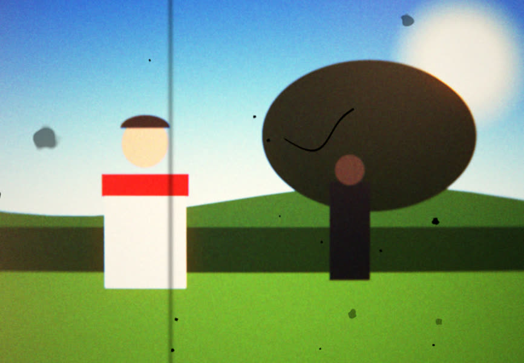
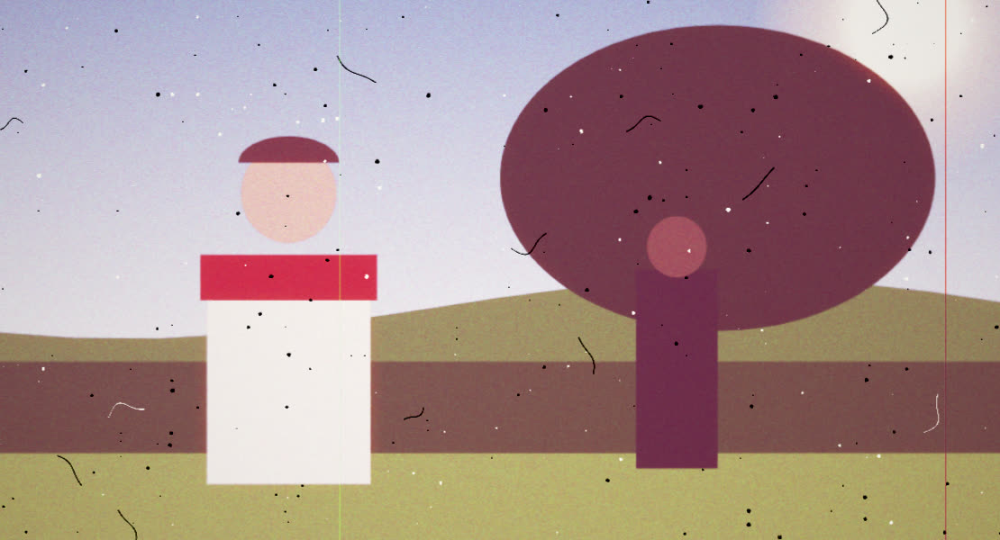
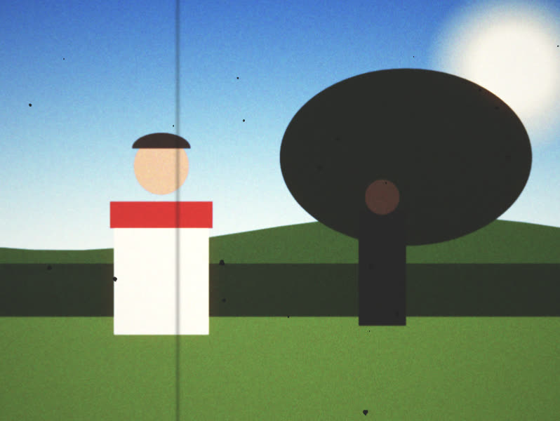
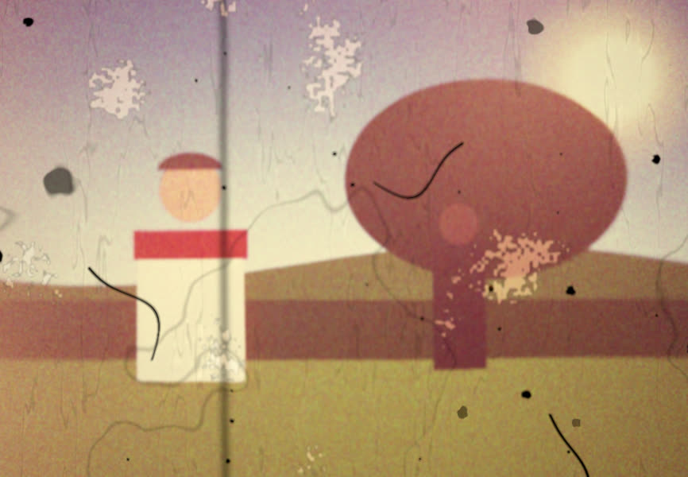

# FILMBOX

**Film stock and format emulation for picture *and* sound.**

A real-time film emulator for video and stills that runs in a browser and ships
as a standalone desktop application and a headless command line. Load a clip and
get a piece of film: Super 8 to 65 mm, reversal or negative, exposed through a
soft zoom, developed on a characteristic curve, printed, faded, scratched, run
through a projector with a hair in the gate — and heard through a magnetic
stripe or an optical track, with the projector clattering in the room once a
frame.

| Super 8 Kodachrome, 1974 | 35 mm release print, fourth generation |
|---|---|
|  |  |
| **16 mm news film, as broadcast** | **Home movie found in a loft** |
|  |  |

*Every image here is the drawn test scene from `src/testing/probe.ts` through a
built-in preset, rendered by `npm run shots`.*

A sibling to [CRTBOX](https://github.com/kingdrainman-debug/Analoguehorrorbox),
which does the same for cathode-ray televisions, and from which FILMBOX was
forked: the parameter schema, the two render backends, the enforced help, the
keyframe timeline, the guide and the packaging all come from there.

📄 **[The design brief](docs/BRIEF.md)** · **[The presets](docs/PRESETS.md)**

---

## The idea

Grain overlays and orange LUTs are a solved, boring problem. FILMBOX models the
**chain** instead: light hits an emulsion, the emulsion has a characteristic
curve, the film goes through a camera with a bad gate, gets developed, printed,
projected or telecined, and ages badly in a cupboard. Every artefact falls out of
modelling a step in that chain, not out of a texture multiplied on top.

That has consequences you can see:

- **Highlights roll off rather than clip** — because the curve has a shoulder,
  and a print stock has a toe. Reversal film, whose curve must span its whole
  density range, clips two stops above grey; a printed negative rolls off over
  four.
- **Grain is on the film.** When the camera's claw misregisters, the image moves
  and the grain stays put. When the projector's gate weaves, picture, grain and
  dust move together. That difference is most of what separates film from a
  grain filter.
- **The format is physical.** Grain comes from the stock's RMS granularity
  through Selwyn's law; halation from the thickness of the base; weave in
  micrometres; lens sharpness in line pairs per millimetre. The same stock is
  7.5× grainier on Super 8 than on 35 mm for the reason it really was — the
  frame is enlarged more — and nothing has to be set twice.
- **Dirt has a polarity.** Dust on a print is black. Dust that was on the
  negative when it was printed held back the printer light, so it prints white.
  A scratch on a print's emulsion is bright and, if shallow, coloured; the same
  scratch on the negative prints dark.
- **Fading is per dye.** A 1970s Eastman print goes pink because its cyan and
  yellow dyes failed and its magenta did not — not because it desaturated.

---

## What is modelled

### Three engines, in the order the light meets them

| Tab | Sections |
|---|---|
| **Lens** | **Exposure** — stops, the scene's light against the stock's balance, the 85 filter Super 8 cameras had on a switch, and how much highlight the source clipped · **Lens** — resolving power in lp/mm, corner falloff, vignetting in stops, lateral colour in µm, distortion, veiling flare · **Anamorphic** — squeeze (which stretches the grain), streak flare |
| **Stock** | **Format & Stock** — gauge, emulsion, camera speed · **Characteristic Curve** — toe, gamma, shoulder, their softness, layer crossover, push/pull · **Grain** — three uncorrelated, clumped, density-dependent layers · **Halation** — red, from the base, radius from its thickness · **Dyes** — interimage and impurity · **Print & Process** — contact print through printer lights, scanned negative, or the raw orange negative; duplicate generations; bleach bypass · **Dye Fading** — years and storage against each dye's own rate |
| **Gate** | **Camera Transport** — registration error, frame jitter, exposure flicker, spring-motor speed drift, flash frames at every camera start · **Projector** — gate weave, projection speed, a 2- or 3-blade shutter beating against the capture camera, lamp ripple, hot spot, focus and film buckle · **Gate Dirt & Hair** · **Film Dirt** · **Scratches** · **Splices & Cues** · **Light Leaks & Fog** — including the fogged head and tail of every cartridge · **Decay** — vinegar syndrome, channelling, mould, water marks, flaking · **Telecine** — 3:2 pulldown with real field combing, transfer tone · **Framing & Output** — projection aspect, overscan to the perforations, output frame rate |

Each tab has a **master switch** that bypasses its whole engine; each section has
its own. They fold down into the section switches before rendering, so the two
backends can never disagree about what "off" means.

### Formats

From the camera apertures in the SMPTE and Kodak references. Perforations are
drawn where they sit relative to the frame, which is what an overscanned
transfer shows.

| Gauge | Aperture | Pitch | Native fps | A load |
|---|---|---|---|---|
| Regular 8 | 4.5 × 3.3 mm | 3.81 mm | 16 | 25 ft run twice, 4,000 frames |
| **Super 8** | 5.79 × 4.01 mm | 4.234 mm | 18 | 50 ft cartridge, 3,600 frames |
| 16 mm | 10.26 × 7.49 mm | 7.62 mm | 24 | 100 ft spool, 4,000 frames |
| Super 16 | 12.52 × 7.41 mm | 7.62 mm | 24 | 400 ft magazine |
| 35 mm Academy | 22.0 × 16.0 mm | 19.0 mm | 24 | 1,000 ft magazine |
| Super 35 | 24.89 × 18.66 mm | 19.0 mm | 24 | 1,000 ft magazine |
| 65 mm 5-perf | 52.48 × 23.01 mm | 23.75 mm | 24 | 1,000 ft magazine |

### Stocks

Camera: **Kodachrome 40**, **Ektachrome 160** (Super 8, 1970s), **Ektachrome
100D**, **Ektachrome VNF 7240** (television news), **Tri-X reversal**, **Vision3
50D / 250D / 500T**, **Eastman Color Negative II 5247**, **Double-X**. Print:
**Vision 2383**, **Eastman Color Print 5381** (the one that went pink),
**Technicolor dye transfer**, **Fine Grain Positive 2302** (black and white).

Each is described by the numbers a data sheet gives — gamma per layer, where a
grey card lands, the straight line's extent, Dmin and Dmax, RMS granularity and
clump size, halation, MTF, dye impurity, and fade rates per dye. They are
approximations read off published curves; the relationships between stocks are
what they should be, which matters more than the third decimal place.

### How the tone works

The characteristic curve is the difference of two softplus functions — flat
below the toe, slope γ along the straight line, flat above the shoulder — with
controllable position and softness at each end. Its total rise is exactly
γ·(shoulder − toe), which is the whole reason reversal has little latitude: it
must span Dmax to Dmin, so its highlight end is (Dmax − Dmin)/γ above its shadow
end, about six stops in all.

Printer lights are not guessed. As a laboratory does, the model finds the
density a grey card produces on the negative and solves for the printer exposure
that prints it at the print stock's aim density; printer points then move from
there, 0.025 log E each. The telecine maps the aim density to video grey and
clear film to white, so video log-luminance is a straight line in print density —
every bend in the picture's tone is a bend in the film's curve.

### Sound — the other half

| Section | |
|---|---|
| **Soundtrack** | magnetic stripe · optical variable area · optical variable density · silent film |
| **Sound Transport** | wow, flutter, and *sprocket modulation* — the pull-down leaking through the loop at the perforation rate |
| **Magnetic Stripe** | hiss, head wear, oxide saturation, dropouts, and **print-through**: the echo of the adjacent winding. Exports render it as a true *pre*-echo |
| **Optical Track** | hard clipping past 100% modulation, variable density's curve distortion, image spread, crackle from dirt, perforation ticks, the **exciter lamp's hum**, and a **bloop** at every splice |
| **Playback & Amplifier** | the **Academy curve**, a home projector's amplifier, valve or transistor overload, mains hum |
| **Speaker & Room** | from a projector's built-in cone to a horn behind the screen; "through the booth glass" |
| **Projector Noise** | the claw once a frame, a worn mechanism's second rattle, the shutter and fan, the motor — added in the room, not through the speaker |

The track's treble ceiling is derived, not set: Super 8 at 18 fps passes the
head at 76 mm/s and stops near 7 kHz; a projector faster than the camera plays
the soundtrack faster and higher, in the preview and the export alike.

### A/V Link

The picture and the sound go through the same machine. Both halves import one
event clock — `public/worklets/film-events.js`, a pure function of frame number
and seed — so they agree without exchanging a message:

- **Weave → clatter.** How hard the claw struck a frame throws it in the gate
  *and* sets the loudness of that frame's clack.
- **Splice → pop.** A splice through the gate jumps the picture and pops the
  soundtrack at the same frame.
- **Dirt → crackle.** The picture's dirt adds crackle to an optical track: the
  same dirty print.
- **Lamp → hum.** One supply feeds lamp and exciter: ripple you see is hum you hear.
- **Speed → pitch.** A camera running slow recorded its sound slow too.
- **Audio → lamp.** Loud passages sag the supply and dim the picture.

---

## Verified, not asserted

`npm test` typechecks, builds, checks that every parameter, section and preset is
documented, then runs `scripts/smoke.mjs`: the built app in a real browser,
driven through its own interface, plus a probe that renders synthetic sources
through the real renderers and **measures the film from pixels**. From the last
run in development:

```
curve     slope toe / mid / shoulder: linear 1.00 / 0.99 · Kodachrome 0.43 / 1.69 / 0.69 · Vision3 + print 0.11 / 1.02 / 0.24
latitude  highlights flatten at +2.1 stops on Kodachrome over 0.9 stops, +3.9 on Vision3 over 3.3
grain     camera weave: grain stays (r=1.00 at 0,0) · projector moves strip 4px: grain follows (r=0.92 at 0,4)
grain     Vision3 250D grain power: Super 8 2.36 · 16 mm 1.09 · 35 mm 0.32 (7.5×)
dirt      frame-to-frame overlap: gate grit 1.00 (stays put while the strip weaves) · film dust 0.02
polarity  dust on reversal: 368 dark px · on a negative, printed: 325 white px
halation  glow beside a white patch on black: R 67 · G 37 · B 29
fading    5381 grey: fresh 119,118,117 → 40 warm years 215,149,174
hold      18 distinct pictures in one second of 59.94 fps video from 18 fps film
pulldown  fields 23232323232323 · 8/20 frames combed · progressive holds 2,1,1,1,2,1,1
splice    splices on frames 11, 18, 24, 44, 50 · picture jumps 64.2/px · pops at 0.61, 1.00, 1.33, 2.44, 2.78 s
purity    frame 9 identical whether rendered after 3, 4, 5 or on its own (GPU and CPU)
cpu       0.00/px apart without grain
audio     projector clatter every 56 ms at 18 fps
export    60 frames of 160×120 for 2.00 s at 29.97 · soundtrack · settings embedded
```

The interface stages cover mounting with every shader linked, a still and a
video reaching the film, keyframes easing between values, the output frame
taking the asked-for shape, every one of 47 picture parameters measurably
reaching the render, the guide and the ⓘ panels, the engine masters, the CPU
toggle, a deterministic export through the UI, and all of it over `file://` as
the packaged app loads it.

---

## Using it

### Desktop

Download from the releases page: a one-click installer or a portable `.exe`. The
build is not code-signed, so SmartScreen asks the first time — **More info → Run
anyway**.

### Command line

The desktop build renders without a window:

```
filmbox --input in.mp4 --output out.mp4 --preset super8-1974
filmbox --input in.mp4 --output out.mov --format prores --preset print35-4th --fps 23.976
filmbox --input in.mp4 --output out.mp4 --settings mylook.filmbox.json --format.stock ektachrome160
```

Any parameter is addressable as `--<group>.<param>`, with the same keys as the
preset JSON. `filmbox --help` lists the options; [docs/PRESETS.md](docs/PRESETS.md)
lists the presets.

### In a browser

```
npm ci
npm run dev
```

The guide opens on first run (<kbd>F1</kbd> brings it back). Every parameter and
section has an **ⓘ** explaining what it physically is, what each end of its range
looks like and when to reach for it.

### Two renderers

**Auto / GPU / CPU** in the header. The GPU path is WebGL2. The CPU path is plain
JavaScript, bottom-row-first so its pixel centres are `gl_FragCoord`'s exactly,
and matches the GPU to 0.00/px with grain off. It exists for machines without
WebGL2, for headless renders, and for bit-identical output. It is much slower:
`npm run bench` prints both, separately for a new film frame (exposed,
developed, printed) and a held one (projector only — a developed frame is cached
and reused while the film frame is held). In this container the GPU rows are
SwiftShader, a software rasteriser, so they are a floor; real hardware is far
faster.

### Timeline & keyframes

Every parameter can be animated: click **◷**, scrub, change the value. Numbers
interpolate; stocks, switches and enums hold, because there is no stock half
way between Kodachrome and Vision3. Per-keyframe easing includes a hard hold —
ramp a light leak in over three frames and out again.

---

## Development

```
npm ci                 install
npm run dev            dev server
npm test               typecheck, build, help & preset check, smoke test
npm run smoke          the smoke test alone (needs a build)
npm run help:check     every parameter, section and preset documented
npm run docs           regenerate docs/PRESETS.md
npm run bench          throughput, both backends
npm run shots          render every preset over the test scene
npm run dist:win       package for Windows
```

Layout:

```
src/core/params.ts       the schema: ~200 parameters, the single source of truth
src/core/help.ts         prose for every parameter and section
src/core/presets.ts      the presets, validated against the schema
src/film/formats.ts      gauges
src/film/stocks.ts       emulsions
src/film/tone.ts         curves, printer lights, fading, the transfer
src/film/clock.ts        output time → film frames, fields, exposure times, events
src/film/passes.ts       numbers both renderers derive the same way
public/worklets/film-events.js   the event clock, shared by picture and sound
public/worklets/filmbox-dsp.js   transport, track and projector processors
src/video/shaders/       camera, down, blur, film, present
src/video/cpu/film.ts    the same passes in JavaScript
src/audio/engine.ts      the Web Audio graph
src/testing/probe.ts     the measurement hook the smoke test uses
```

### Honest notes

- Stock figures are approximations from published data sheets and known
  behaviour, not measurements of film.
- The Windows installer is built and verified by the Windows workflow, not in
  this repository's development container; there, an unpacked Windows build and
  a Linux headless render under xvfb were checked.
- Magnetic print-through is a true pre-echo only in exports. The live preview
  cannot look a reel's turn into the future, so it plays the echo after.
- In the live preview the source is sampled when each film frame begins, from
  wherever the video element is; exports seek to each frame's exact exposure
  time, including a drifting camera's.
- When a pulldown frame needs two film frames in the live preview, both come
  from the video element's current frame; exports seek for each.

---

MIT licensed. Forked from CRTBOX, also MIT.
