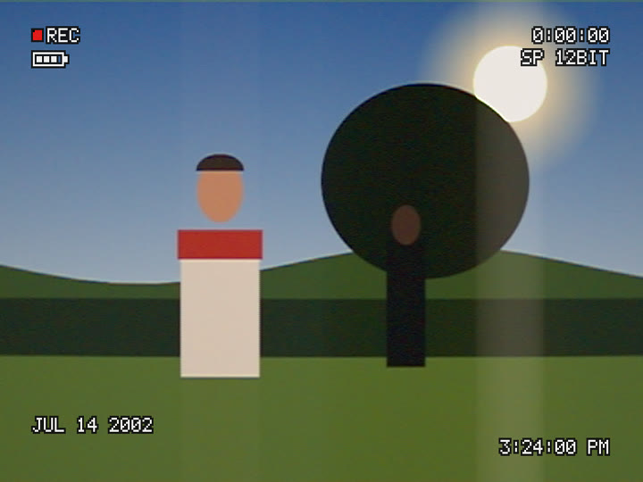
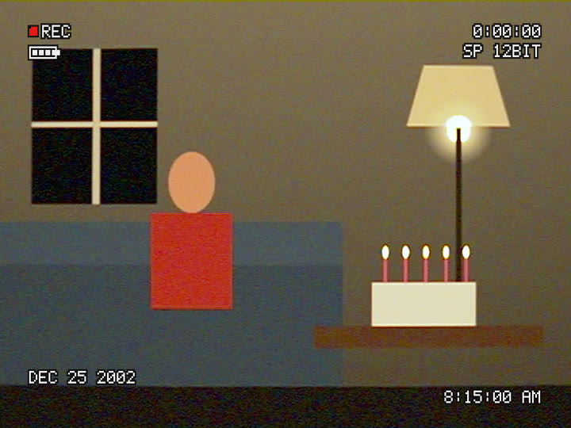
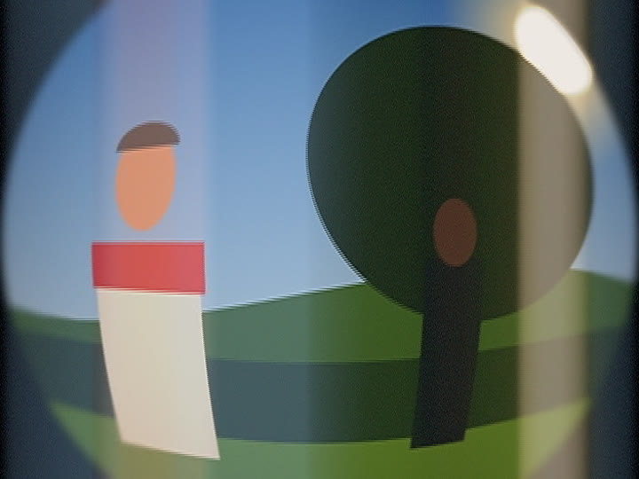
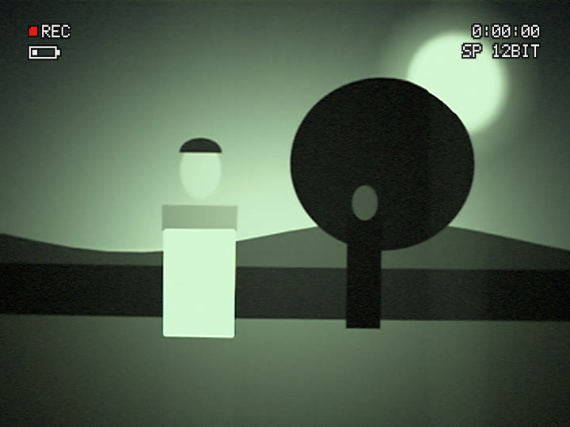
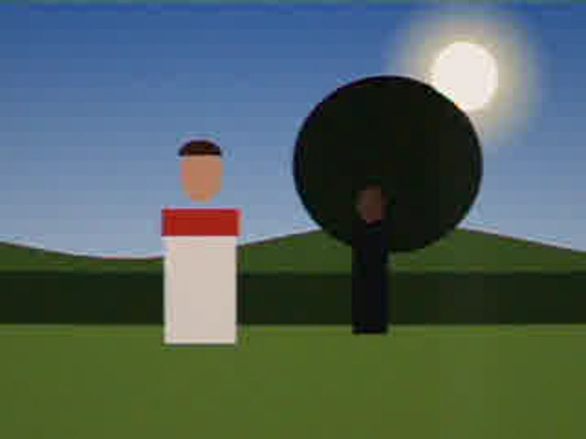
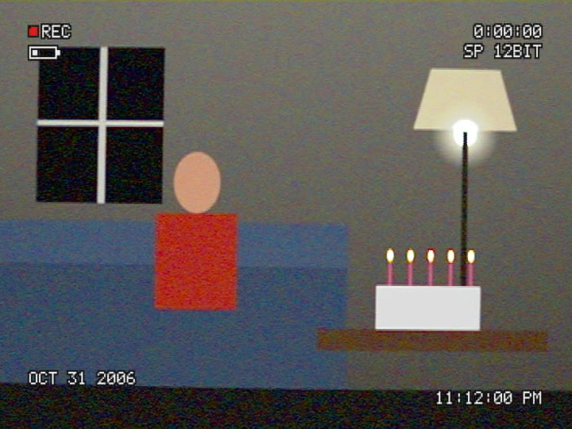

# CAMAI

**Camcorder emulation for picture *and* sound.**

A real-time camcorder emulator for video and stills that runs in a browser and
ships as a standalone desktop application and a headless command line. Load a
clip and it becomes the world in front of a consumer camcorder of 1995–2008:
held by someone who is not a camera operator, seen through a small cheap zoom
by a CCD the size of a fingernail read out in interlaced fields, chased by an
automatic camera, sharpened by its DSP, crushed into 8×8 blocks by a DV codec
with a fixed bit budget, dropped out by a tape, captured through a cheap card,
and uploaded to a 2006 video site — with the microphone on the camera body
hearing the transport, the zoom motor and the REC button.

| MiniDV palmcorder, 2002 | Christmas morning, 2002 |
|---|---|
|  |  |
| **Skate video, 2001** | **Night mode in the woods** |
|  |  |
| **Found tape, captured in 2006** | **Found-footage imitation** |
|  |  |

*Every image here is a drawn test scene from `src/testing/probe.ts` through a
built-in preset, rendered by `npm run shots`.*

The third in a family:
[CRTBOX](https://github.com/kingdrainman-debug/Analoguehorrorbox) does
televisions and VHS, [FILMBOX](https://github.com/kingdrainman-debug/Filmbox)
film stocks and formats. CAMAI is forked from FILMBOX, history and all: the
parameter schema, the engine masters, the shared event clock, the two render
backends, the probe, the enforced help, the keyframe timeline, the guide and
the packaging come from there; the composite capture is adapted from CRTBOX.

📄 **[The design brief](docs/BRIEF.md)** · **[The presets](docs/PRESETS.md)**

---

## The idea

A VHS overlay PNG, a blur, a REC dot and a date in a pixel font is a solved,
boring problem. CAMAI models the chain instead, and every artefact comes from
one step of it:

1. A small cheap lens throws light onto a CCD the size of a fingernail.
2. The CCD reads out in interlaced fields and smears where it is overloaded.
3. An automatic camera chases exposure, focus and white balance.
4. Its DSP sharpens every edge.
5. A codec with a fixed bit budget crushes the result into 8×8 blocks.
6. A tape drops out.
7. Someone captures it over FireWire, or through a cheap analogue card, and
   uploads it to a 2006 video site.

Some consequences that fall out of modelling rather than imitating:

- **Gain noise starves the codec.** The noise is in the signal before the
  codec, and DV gives every five macroblocks a fixed number of bits, so a
  dark room with the gain up blocks far worse than a bright one — everywhere
  at once, including where the noise is not, because each segment's five
  macroblocks come from five places across the frame.
- **Daylight footage is crisp and jittery** because the automatic exposure
  raises the shutter to 1/1000 s rather than stop down into diffraction —
  and a faster shutter makes the CCD's smear stronger relative to the
  picture, which is why streetlights and the sun draw their stripes.
- **The single-chip camera's colour** is decoded from complementary filter
  sums and differences, one colour difference per line: low colour
  resolution, false colour on fine detail, muddy reds, and a blown sky that
  goes cyan or yellow at its edge before it goes white.
- **The REC overlay was never on the tape.** Where an overlay enters the
  chain decides what the chain does to it: burned in before the codec it
  rings and bleeds; drawn on the AV output it sits crisply on the blocks and
  softens with any analogue capture after it.
- **The camera always has sound**: with a silent clip, the soundtrack is the
  camera's own transport, locked to the frame rate.

---

## What is modelled

### Three engines, in the order the picture meets them

- **Camera** — the operator (tremor, sway, walking, bumps, whip pans, a
  keyframable pan, tilt and roll, all of it magnified by the zoom); the lens
  (zoom, softness, corners, vignetting, lateral colour, veiling flare,
  diffraction at the f-number the camera chose, wide and fisheye adapters);
  exposure (scene light, iris, shutter and gain steered together with lag and
  overshoot, backlight compensation, fluorescent flicker beating with a fast
  shutter); the sensor (complementary CCD, three CCDs or Bayer CMOS; full
  wells per filter, blooming, column smear, read and shot noise); contrast-
  detection autofocus that hunts; grey-world white balance that stops short of
  tungsten and ignores green; electronic stabilisation that steadies the frame
  but not the blur; digital zoom; the knee and the white clip with
  superwhites; detail enhancement with coring and a limiter; the battery;
  infrared night mode; the effects button and the fader.
- **Tape** — interlace (two moments a frame, bottom field first, field
  integration); 4:1:1 or 4:2:0 chroma; the DV codec (8×8 DCT with 8-8 and
  2-4-8 modes, activity classes, DV's coefficient weighting, segment rate
  control over shuffled macroblocks, overflow truncation, 8-bit samples);
  tape errors (dropouts concealed on the macroblock grid, head clogs); and
  recording breaks.
- **Display** — the camera's viewfinder display and the date, each with its
  own path into the chain; the capture (FireWire, S-Video, composite with a
  notch or comb decoder); deinterlacing (weave, bob, blend, discard); the 2006
  upload; scaling to the output with the right pixel aspect.

### Native raster, sized in the medium

Everything up to the display is rendered in the DV raster — 720 × 480 or
720 × 576 — and only then scaled to the output. An 8×8 block is 8×8 DV
pixels and about 18×18 on a 1080p output; an OSD glyph is cells of two DV
samples by two lines; smear is a sensor column.

### The clocks

`src/cam/clock.ts` turns output time into DV frames and two fields, each with
its own moment of the source; a slow shutter integrates several. Recording
breaks separate three clocks: **source time** (the world), **tape time**
(shots butted together: the counter, which runs straight across a break) and
**wall time** (tape time plus the gaps between shots: the date, which jumps).
`public/worklets/camai-events.js` holds every event — shots, dropouts, clogs,
the operator's hand, focus hunts, the battery — as pure functions of time and
seed, imported by both the renderer and the audio worklet, so they agree.

### Sound

One AudioWorklet in tape time: the microphone on the body (capsule EQ, room
tone, wind, wind cut) hearing the camera (the drum's whine at about 150 Hz
locked to the frame rate, the capstan, the zoom motor following the zoom's
speed, the focus motor ticking while it hunts, the REC clunk, a thump for
each bump); automatic gain control with attack, release and a ceiling; DV
audio as 16-bit 48 kHz or 12-bit non-linear band-limited for 32 kHz; the
tape's dropouts muting or stuttering the frames the picture conceals; breaks
cutting dead with a click.

### A/V Link

Only physical couplings: the zoom's speed is the motor's whirr; a focus hunt
is the focus motor ticking; a recording break is a cut, a clunk and a dead
stop; a dropout mutes the audio on the same damaged tracks; a bump is a jolt
and a thump; the transport's whine is locked to the frame rate.

---

## Verified, not asserted

`npm test` typechecks, builds, checks that every parameter, section and preset
is documented, then runs `scripts/smoke.mjs`: the built app in a real browser,
driven through its own interface, plus a probe that renders synthetic sources
— drawn at the exact moment each field asks for — through the real renderers
and **measures the camcorder from pixels and samples**. From the last run in
development (headless Chromium, software WebGL, 15.5 minutes):

```
smoke test passed
mount      app mounted · all 19 programs linked on WebGL2
picture    83.1% lit · contrast 0.99 · flat-bar texture p90 2
video      element 184 · picture 82.7% lit
audio      worklet ok · silent clip still has the camera (rms 3.0e-1) · 12-bit −27 dB above 16 kHz · AGC lifts the room +9.5 dB
keyframes  2 markers · brightness 133 → 93 → 64
framing    forced 16:9 → 1.778 · 4:3 camera → 1.333 · 16:9 camera → 1.778
purity     gpu: everything off → source within 0.36/px (the DV raster's resampling)
purity     cpu: everything off → source within 0.36/px (the DV raster's resampling)
purity     frame 9 identical whether rendered after 3, 4, 5 or on its own
packaged   file:// mounted 44908 chars · 99.8% lit · worklet ok
sections   23/23 sections measurably reach the render
guide      shown, closes, reopens, 10 cameras, remembered, F1 · ⓘ 235 / 739 chars
fields     top field is 9.8 px later (expect 9.8): bottom first · top-first -9.8 · progressive 0.00
deinterlaceweave combs on motion 8.71/px vs still 0.00 · bob 0.00 · discard keeps 50% of line-pair detail
blocking   boundary/interior 1.38 with the codec, 1.00 without · at 1080p the error steps 1.15× on the scaled block grid, 1.02× on an unscaled one
budget     noise in a third of the frame: right third 52.8 → 52.2 dB, mean quantiser 15.0 → 7.5
dvvideo    emulation/FFmpeg, codec error only: scene 54.4/55.2 dB blk 1.11/1.19 · zone 37.7/38.0 dB blk 1.20/1.30 · noise 44.0/46.2 dB blk 0.82/0.88
chroma     red line: 4:1:1 → 4 px wide, 1 rows · 4:2:0 → 2 px wide, 4 rows
detail     edge overshoot +30.0 / −17.0 (off: +0.0) · noise 5.09 → 1.38 with coring
sensors    CCD point light → column +92.0 bottom, +92.0 top; CMOS +0.0 · pan lean: CCD 0.0 px, CMOS -7.9 px
knee       slope 34 → 22 → 0.0 /stop: knee and wall · near clip, chroma excursion 11 single-chip vs 0 three-chip
overlays   before the codec: bleed 1.89 ring 0.62 · after decode: bleed 0.00 ring 0.00 · composite capture keeps 61% of the edges
clocks     2 breaks in 10 s: date jumps ≥ 1 min each, counter continuous, first cut at frame 120 (Δ 8.4 vs median 0.7)
dropouts   265 lost macroblocks, each exactly the previous frame (max diff 0) · 3 whole-frame dropouts muted the sound at the same frames, 0 missed
avlink     zoom motor 53 dB louder while the zoom moves · break: cut frame 120, clunk frame 120
cpu        flagship, third frame: GPU and CPU 0.025/px apart · CPU 2436 ms/frame vs GPU 2789
cpu        header toggle → CPU: 83.4% lit
masters    each master equals its tab's switches by hand · bypass changes the picture camera 32.9 · tape 0.7 · display 3.8 /px
export     59 frames of 640×480 for 2.00 s at 29.97 · audio 375 KiB · settings embedded
export     DV ntsc: dvvideo, yuv411p, 720x480 [SAR 8:9 DAR 4:3] · pcm_s16le, 48000 Hz
export     DV pal: dvvideo, yuv420p, 720x576 [SAR 16:15 DAR 4:3] · pcm_s16le, 48000 Hz
```

The codec is also compared against **FFmpeg's own `dvvideo` encoder**, on the
same pre-codec frame, codec error only (each against its own 4:1:1
reference). The emulation's rate control is an approximation — the bit cost
of DV's variable-length code is modelled, not tabulated — calibrated against
the real encoder. In development (525/60):

| source | PSNR, emulation | PSNR, FFmpeg | blocking ratio, emulation | blocking ratio, FFmpeg |
|---|---|---|---|---|
| drawn scene | 54.4 dB | 55.2 dB | 1.11 | 1.19 |
| zone plate | 37.7 dB | 38.0 dB | 1.20 | 1.30 |
| gradient with a noise patch | 44.0 dB | 46.2 dB | 0.82 | 0.88 |

So: within a dB of the real encoder on smooth and structured pictures, and
about 2 dB worse on fine noise, where the modelled bit costs are least exact.
Its blocks are a little weaker than DV's throughout. The smoke test fails if
any of these drift more than 4 dB or 0.3 in blocking ratio from FFmpeg.

---

## Using it

### Desktop

Download from the releases page: a one-click installer or a portable `.exe`.
The build is not code-signed, so SmartScreen asks the first time — **More info
→ Run anyway**.

### Command line

The desktop build renders without a window:

```
camai --input in.mp4 --output out.mp4 --preset palmcorder-2002
camai --input in.mp4 --output out.dv --format dv --preset christmas-2002
camai --input in.mp4 --output out.mp4 --settings mylook.camai.json --format.sensor ccd3
```

Any parameter is addressable as `--<group>.<param>`, with the same keys as the
preset JSON. `camai --help` lists the options; [docs/PRESETS.md](docs/PRESETS.md)
lists the presets.

### DV export

`--format dv` (or **DV · .dv** in the export panel) writes a real DV stream,
720 × 480 or 720 × 576, interlaced, bottom field first, with PCM audio. The
picture is rendered up to the codec — the camera, its interlace and anything
burned in — and FFmpeg's `dvvideo` encoder does the DV encoding, so the codec
in the file is the codec in the file. Tape errors and the display stages are
playback, not recording, and are left out.

### In a browser

```
npm ci
npm run dev
```

The guide opens on first run (<kbd>F1</kbd> brings it back). Every parameter
and section has an **ⓘ** explaining what it physically is, what each end of
its range looks like and when to reach for it.

### Two renderers

**Auto / GPU / CPU** in the header. The GPU path is WebGL2, nineteen passes.
The CPU path is plain JavaScript mirroring every pass, top row first as every
shader addresses its images, with the same integer hash for noise; the smoke
test holds them to within half a level a pixel on the flagship. It exists for
machines without WebGL2, for headless renders, and to check the GPU. It is
slower: `npm run bench` prints both. In this container the GPU rows are
SwiftShader, a software rasteriser, so they are a floor.

### Timeline & keyframes

Every parameter can be animated: click **◷**, scrub, change the value.
Numbers interpolate; switches and choices hold. Animate the zoom and the motor
is heard while it moves and the display shows its zoom bar; animate the scene
light from a room into daylight and the exposure blows out and pumps down.

---

## Development

```
npm ci                 install
npm run dev            dev server
npm test               typecheck, build, help & preset check, smoke test
npm run smoke          the smoke test alone (needs a build)
npm run help:check     every parameter, section and preset documented
npm run docs           regenerate docs/PRESETS.md
npm run bench          throughput, both backends
npm run shots          render every preset over the test scenes
npm run dist:win       package for Windows
```

Do not run `shots` or `bench` alongside the smoke test: the contention fails
its timing-sensitive stages for reasons unrelated to what they test.

Packaging for Windows from Linux needs Wine with 32-bit support (the NSIS step
runs the installer it has just built), and `ffmpeg-static` holding the Windows
binary instead of the Linux one, since the whole package is bundled:

```
mv node_modules/ffmpeg-static/ffmpeg /tmp/ffmpeg-linux
npm_config_platform=win32 npm_config_arch=x64 node node_modules/ffmpeg-static/install.js
npm run dist:win
rm node_modules/ffmpeg-static/ffmpeg.exe*; mv /tmp/ffmpeg-linux node_modules/ffmpeg-static/ffmpeg
```

Layout:

```
src/core/params.ts        the schema: 183 parameters, the single source of truth
src/core/help.ts          prose for every parameter and section
src/core/presets.ts       the presets, validated against the schema
src/cam/clock.ts          output time → DV frames, fields, source moments, shots, the clocks
src/cam/automatics.ts     automatic exposure and white balance, with memory
src/cam/plan.ts           every number both renderers use, per field and per frame
src/cam/dvlayout.ts       macroblocks, superblocks and the segment shuffle
src/cam/osd.ts            the character generator: an original 5×7 font, two layers
public/worklets/camai-events.js   the event clock, shared by picture and sound
public/worklets/camai-dsp.js      the camera's sound
src/video/shaders/        scene, blur, smear, sensor, demod, dsp, chroma, fdct,
                          blockinfo, cost, qno, dequant, idct, assemble, post,
                          updown, upfdct, upidct, present
src/video/cpu/            the same passes in JavaScript
src/audio/engine.ts       the Web Audio graph
src/testing/probe.ts      the measurement hook the smoke test uses
electron/encode.cjs       FFmpeg arguments for every export format, DV included
```

### Honest notes

- **The codec is approximate where the table above says so.** Rate control
  picks one quantiser per segment of five macroblocks (the real encoder can
  vary it per macroblock) and costs bits with a fitted formula rather than
  DV's VLC table. The 2-4-8 transform uses the ordinary zigzag scan. The
  superblock partition follows the standard's shape — bands of 135
  macroblocks, five columns of 27, segments drawn from rows i+2, i+6, i+8, i,
  i+4 — but the order inside a superblock is simpler than the standard's
  serpentine; nothing visible depends on it.
- **Figures to verify against the standard**, used as the brief gave them or
  from memory of FFmpeg's tables: the quantiser shift table and class
  offsets; the class thresholds (scaled to this implementation's DCT units);
  the 8-8 weighting; 4:2:0 chroma siting (averaged across the two fields
  here); the 12-bit companding segments; tape speeds and tracks per frame.
- **The sensor is a model, not a measurement.** Filter overlap, full well,
  smear and noise are set to look right and behave right — smear rising with
  shutter speed, noise multiplied by gain — not taken from a data sheet. The
  complementary mosaic's decoding matrix undoes half the filters' overlap by
  design.
- **The source's highlights are guessed.** A clipped source cannot say how
  bright the sun was; values in its top few percent are opened up by
  *Highlight headroom* so a bulb can fill wells and smear while a white shirt
  barely changes.
- **Rolling shutter** samples the camera's own motion — pans, shake, whips —
  row by row, exactly. Subject motion is sampled once a field, because the
  source only has the frames it has.
- **The automatics have memory.** A frame depends on the frames before it in
  the shot. They step once a field in order, catch up across short gaps in the
  preview, and settle instantly after a seek. An export always steps from its
  first frame, so it is reproducible, but an export starting mid-clip starts
  settled rather than with the preview's history.
- **Concealment** substitutes the previous decoded frame. After a seek there
  is none, so the first frame conceals with grey blocks.
- **Composite capture** uses NTSC-style comb filtering in both systems; PAL's
  delay-line decoder is approximated.
- **12-bit audio** is band-limited and companded at 48 kHz rather than
  resampled to 32 kHz and back; the DV file export writes 16-bit 48 kHz PCM,
  which is what FFmpeg's DV muxer supports.
- **The analogue camcorders** (Video8, Hi8, VHS-C, with the date imprinted)
  and the MPEG-2 ones (HDV, DVD, hard disk) are a later milestone. The
  imprint path is already here; the analogue tape passes are not.
- **The Windows build** has not been run on Windows from this repository.
  The release workflow builds the installer and the portable exe on a real
  Windows runner on a `v*` tag. FILMBOX's experience stands: Chromium's
  renderer does not start under Wine, so a Wine build can be installed and
  uninstalled but not rendered with.
- The presets describe objects, never brands; the font and the overlay
  layouts are drawn for this project, not lifted from any camera.

---

MIT licensed. Forked from FILMBOX, itself forked from CRTBOX, both MIT.
